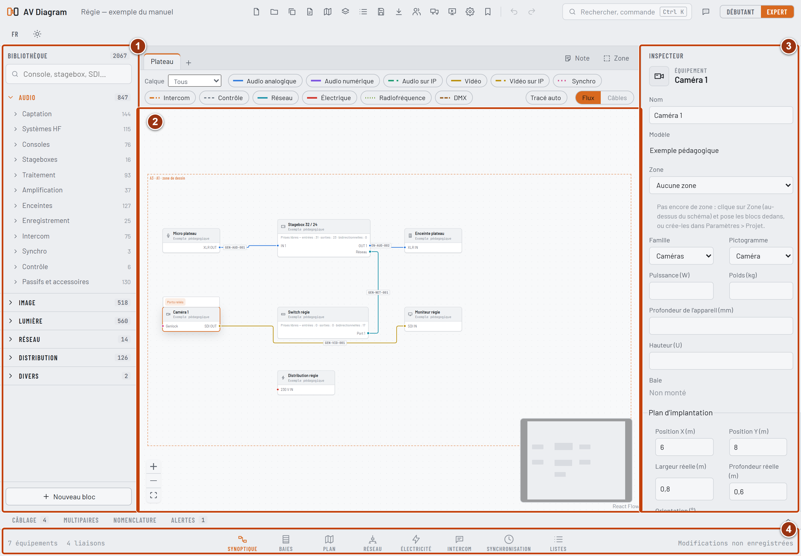
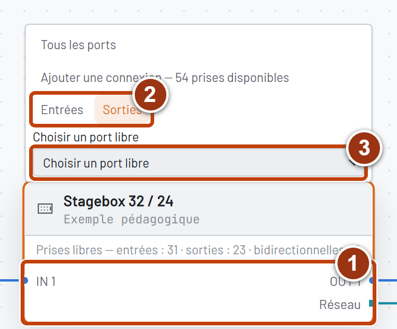
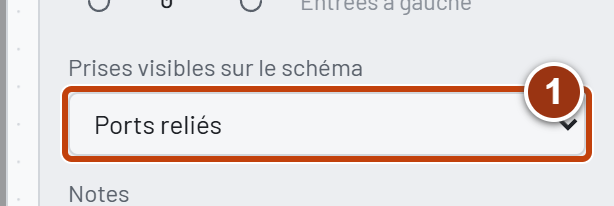
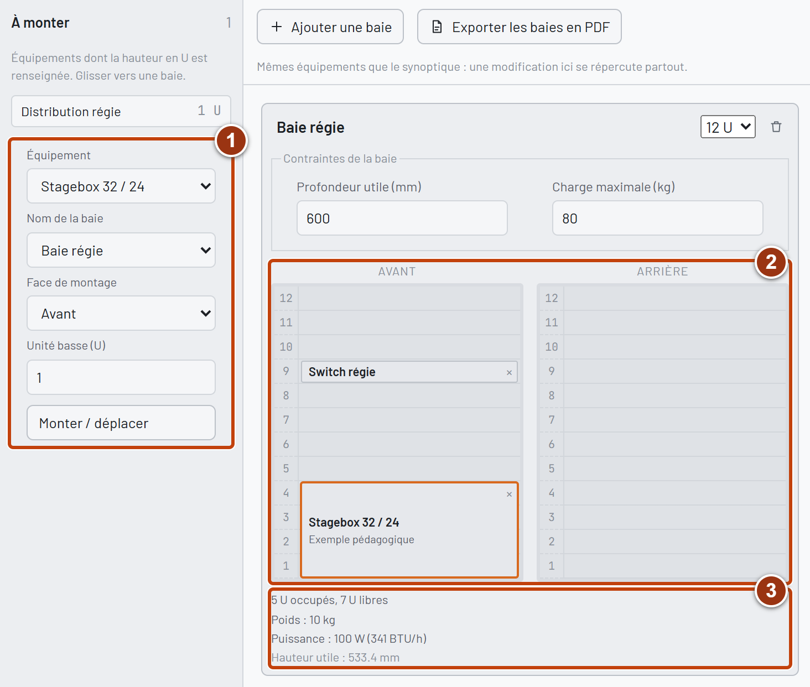
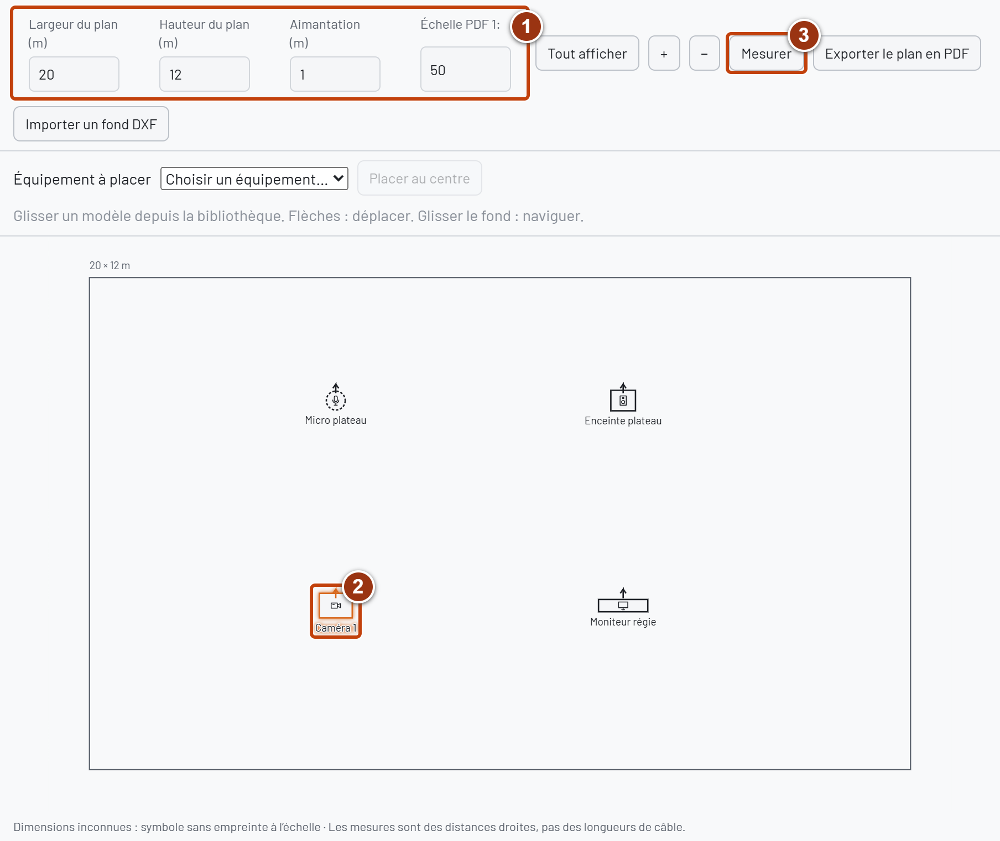
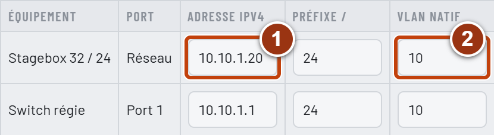
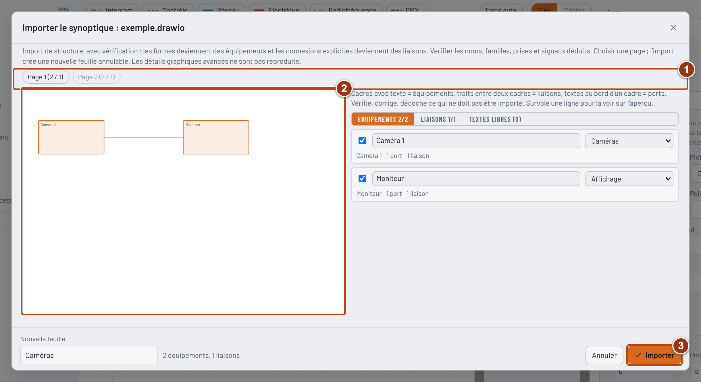
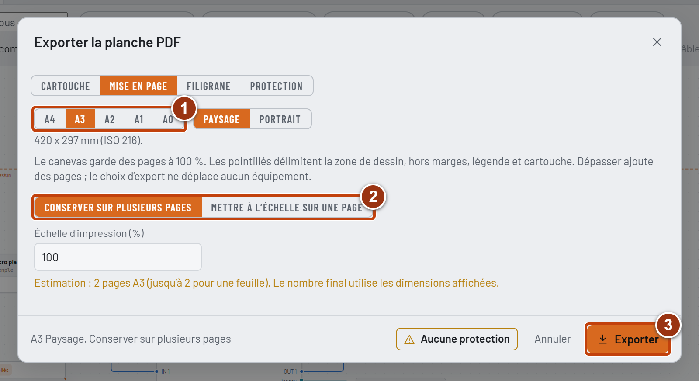

# AV Diagram — Manuel utilisateur

Version 0.5.0 · Édition du 21 octobre 2026 · Windows et macOS

AV Diagram sert à préparer et documenter une installation audiovisuelle : synoptique, implantation, baies, câblage et tableaux techniques. Les vues partagent les mêmes équipements. Le logiciel reste en développement ; vérifier les documents produits avant leur utilisation sur un chantier.

## 1. Démarrer et se repérer

L'application fonctionne sur le poste de travail. Aucun compte n'est nécessaire pour créer un projet, dessiner, enregistrer ou exporter. Une session collaborative utilise le réseau local. Le cloud et l'assistant IA ne sont pas nécessaires à ces usages.

Au lancement, choisir Nouveau projet, Reprendre le dernier projet ou ouvrir un fichier .avd. Les projets récents permettent de retrouver un travail déjà ouvert sur ce poste. Retirer un raccourci de cette liste ne supprime pas le fichier correspondant.

La barre supérieure contient les commandes de fichier, les imports, les exports, la collaboration, l'affichage sur deux écrans, la présentation, les paramètres et l'annulation. Le bouton Manuel ouvre ce document sans connexion Internet et permet d'enregistrer son PDF.

La bibliothèque occupe la gauche ; le schéma ou la vue technique se trouve au centre ; l'inspecteur montre les propriétés de la sélection à droite. Le panneau inférieur réunit les listes et alertes. La barre du bas change de vue : Synoptique, Baies, Plan, Réseau, Électrique, Intercom, Synchronisation ou Listes.

Les captures de ce manuel montrent l'interface réelle en français, avec un projet pédagogique fictif. Les cadres et numéros ajoutés repèrent les éléments expliqués dans la légende. Les valeurs saisies dans cet exemple ne constituent pas des caractéristiques constructeur. Agrandir le PDF pour examiner un détail.

Repères : 1. Bibliothèque des équipements à placer ; 2. Canevas du synoptique ; 3. Inspecteur de l'appareil sélectionné ; 4. Boutons de changement de vue.

Le mode Débutant présente les opérations essentielles et des indications de progression. Le mode Expert expose davantage de propriétés, les ports personnalisés et les modèles personnels. Les deux modes utilisent le même projet. Les thèmes clair, sombre ou système et la langue se règlent dans la barre supérieure.

## 2. Créer et organiser un projet

Choisir Nouveau projet, saisir un nom, choisir le dossier parent et le format de papier, puis sélectionner un départ vide ou un modèle. Un modèle constitue un exemple de travail à adapter aux appareils et au câblage réels.

L'application de bureau crée un dossier au nom du projet. Il contient le fichier principal .avd et le dossier Save Back Up. Si ce nom existe déjà, un numéro est ajouté au nouveau dossier ; le projet existant n'est pas écrasé. Les exports sont proposés à côté du fichier principal ; leur destination reste modifiable.

Les onglets supérieurs du synoptique représentent des feuilles logiques. Une feuille peut occuper plusieurs pages physiques A3, A4 ou d'un autre format. Ajouter et renommer des feuilles pour séparer plateau, régie ou distributions. Déplacer un équipement vers une autre feuille conserve son identité et ses connexions ; les câbles qui changent de feuille sont représentés par des renvois.

Une zone associe un nom et un code à une partie du projet. Un cadre de zone placé sur le schéma peut affecter automatiquement les équipements qu'il contient. Les codes de zone participent à la numérotation des câbles selon le format choisi dans les paramètres. Vérifier les repères après un changement de zone ou de numérotation.

## 3. Enregistrer, sauvegarder et récupérer

Ctrl+S sous Windows ou Cmd+S sur Mac enregistre la version courante en remplaçant le fichier principal .avd. Le bouton Enregistrer effectue la même opération. Les modifications courantes ne remplacent pas ce fichier en continu. Ctrl+Maj+S ou Cmd+Maj+S propose Enregistrer sous.

Dans Paramètres > Enregistrement, définir l'intervalle des copies de sécurité et le nombre de copies à conserver. Ces copies sont automatiques et distinctes du fichier principal. Avec dix copies conservées, la onzième supprime la plus ancienne copie de ce projet. Les copies sont rangées dans Save Back Up, avec un sous-dossier stable par projet ; deux projets de même nom restent indépendants.

Une copie automatique ne fait pas passer l'indicateur du fichier principal à « enregistré ». Enregistrer sous ne déplace pas les anciennes sauvegardes. Les copies suivantes suivent le nouvel emplacement ; un dossier de secours peut être utilisé si l'emplacement principal devient inaccessible. Les paramètres indiquent le chemin réellement utilisé.

Fermer l'application ou changer de projet propose Enregistrer, Ne pas enregistrer ou Annuler lorsqu'il reste des modifications. Enregistrer doit réussir pour poursuivre la fermeture. Ne pas enregistrer ferme sans remplacer le .avd par les dernières modifications. Annuler permet de continuer à travailler.

Une copie interne sur le poste aide à reprendre après un arrêt inattendu ; elle ne remplace pas le .avd et les sauvegardes de sécurité. Pour récupérer une copie de Save Back Up, ouvrir le fichier choisi, contrôler le contenu, puis utiliser Enregistrer sous afin de conserver aussi le fichier d'origine.

Conserver une copie avant de tester une nouvelle version du logiciel ou de revenir à une version plus ancienne. Les champs ajoutés récemment peuvent ne pas être exploités par une ancienne application.

## 4. Utiliser la bibliothèque

Les menus Audio, Image, Lumière, Réseau, Distribution et Divers regroupent les familles d'équipements. La recherche accepte des noms, fabricants et références. Le calque actif peut filtrer les propositions ; Tout afficher permet d'élargir la recherche.

Glisser un modèle sur le synoptique crée une instance. Plusieurs instances d'un même modèle peuvent recevoir des noms et des affectations différents. Dans l'inspecteur, vérifier le nom, la zone, les notes et les caractéristiques utiles au projet.

Les statuts distinguent les modèles génériques, les fiches Vérifié, les fiches Communauté et les modèles personnels. Vérifié indique une documentation référencée ; ce statut ne dispense pas de contrôler la variante, la carte ou l'option réellement installée. Communauté signifie que des informations restent à vérifier. Une fiche sans ports documentés reste utilisable pour le placement et les listes ; aucune prise manquante ne doit être supposée présente.

Le catalogue Novelty français est référencé hors Structure. Les caractéristiques inconnues restent vides. Les variantes réellement différentes sont conservées ; les synonymes d'un même produit peuvent être regroupés. Les fiches constructeur servent à compléter la connectique, les dimensions, le poids et la puissance ; une image commerciale seule ne suffit pas à établir ces valeurs.

En mode Expert, créer ou ajuster les ports d'un équipement, puis enregistrer un modèle dans Mes modèles. Une nouvelle instance issue d'un modèle ne doit pas reprendre les adresses IP et les affectations de déploiement d'un autre projet. Vérifier aussi les options de carte et le type de slot avant leur réutilisation.

## 5. Dessiner et manipuler les équipements

Cliquer sélectionne un élément. Un cadre de sélection dans le vide sélectionne les blocs inclus et les câbles touchés. Maj ou Ctrl avec un clic ou un cadre ajoute ou retire des éléments de la sélection. Échap désélectionne lorsque aucun dialogue n'est ouvert. Les commandes du clic droit regroupent les actions courantes.

Glisser un bloc change sa position. La molette, le clic milieu ou Espace avec un glisser permettent de naviguer selon le dispositif de pointage. Le zoom et l'ajustement de vue sont accessibles sur le canevas. F affiche l'ensemble du dessin ; la recherche permet de retrouver un appareil ou une commande.

R fait pivoter la sélection d'un quart de tour ; Maj+R tourne dans l'autre sens. Les ports changent de côté et les câbles sont recalculés. La rotation du bloc dans le synoptique est indépendante de l'orientation physique dans le plan.

Les outils d'alignement et de répartition servent à organiser plusieurs équipements. Dupliquer crée d'autres instances ; les prises reçoivent leurs propres identifiants. Une adresse IP est effacée lors d'une duplication et un rôle d'horloge maître forcé redevient automatique afin d'éviter une affectation involontaire en double.

Les notes et cadres complètent la présentation. Grouper la sélection crée un sous-schéma ; ouvrir son bloc permet de travailler à l'intérieur. Dégrouper replace le contenu sur la feuille parente. Conserver le .avd pour garder cette organisation lors d'un échange avec un autre logiciel.

## 6. Replier les prises d'un appareil

Le comportement est commun à toutes les familles : stagebox, caméra, console lumière, mélangeur, switch ou autre appareil. En mode Automatique, les appareils de plus de 16 prises n'affichent que les prises reliées. Ceux de 16 prises ou moins restent complets.

Sélectionner un appareil fait apparaître Tous les ports ou Ports reliés. Ce dernier choix peut aussi replier un petit appareil. Dans l'inspecteur, Prises visibles sur le schéma permet de choisir l'un des deux modes ou de revenir à Automatique. Le choix est enregistré dans le projet, partagé avec les collaborateurs et annulable.

En mode replié, Ajouter une connexion indique le nombre de prises libres accessibles dans le calque autorisé. Choisir Entrées, Sorties ou Bidirectionnels, puis le port dans la liste regroupée par signal. La prise apparaît temporairement pour raccorder le câble. Une fois reliée, elle reste visible. Masquer ce port annule l'affichage temporaire sans supprimer la prise.

Les noms et numéros d'origine restent les mêmes. Les prises reliées vers une autre feuille restent visibles avec leur renvoi. Replier ne supprime aucun port ni câble. Les tableaux conservent les données complètes ; les exports graphiques reprennent la présentation choisie.

Repères : 1. Les prises déjà reliées restent visibles ; 2. Après Ajouter une connexion, choisir Entrées ou Sorties ; 3. Choisir le port libre, puis tirer son câble. L'exemple comporte 32 entrées audio, 24 sorties audio et une prise réseau.

Repères : 1. Dans l'inspecteur, Prises visibles sur le schéma propose Automatique, Tous les ports ou Ports reliés. Le réglage concerne l'appareil sélectionné.

## 7. Relier et contrôler le câblage

Tirer un câble d'une poignée de port à l'autre. Les ports compatibles peuvent être mis en évidence pendant l'opération. Un port bidirectionnel peut servir d'extrémité dans les deux sens ; le sens du flux doit rester cohérent avec l'installation réelle.

Le logiciel compare notamment les familles de signaux, les directions, les connecteurs et certaines caractéristiques déclarées. Une liaison douteuse ouvre une fenêtre permettant de l'annuler, de la conserver ou de ne plus signaler ce contrôle pour ce schéma. Les contrôles ignorés restent consultables et réactivables. L'absence d'alerte ne prouve pas qu'un appareil ou un câble réel est adapté.

Sélectionner un câble pour renseigner sa longueur, sa référence, ses canaux et ses notes. Les repères suivent les zones et le format de numérotation du projet. Les données non renseignées ne sont pas remplacées par des valeurs constructeur supposées.

Relier en série raccorde les sorties sélectionnées aux entrées libres d'une destination, à partir d'un port choisi. Contrôler l'ordre de départ et d'arrivée avant d'appliquer. Un multipaire regroupe plusieurs liaisons sous un câble physique commun ; les paires et les extrémités restent distinctes.

La vue Flux montre les liaisons logiques ; la vue Câbles regroupe les branches d'un multipaire. Le tracé automatique contourne les blocs et ordonne les voies. En sélectionnant un câble, déplacer sa poignée pour régler un coude ; les deux axes sont pris en charge selon l'orientation des ports. Les flèches déplacent la poignée de 5 unités et Maj multiplie ce pas par dix. Réinitialiser le tracé rend la main au calcul automatique. Annuler rétablit le réglage précédent.

## 8. Calques et travail collaboratif en LAN

En travail individuel, les calques Audio, Image, Lumière, Réseau et Électrique aident à lire le même projet. Ils ne constituent pas des copies indépendantes des appareils : une caméra peut porter de l'image, de l'audio, du contrôle et de l'alimentation.

Pour héberger une session, ouvrir le projet puis Session Collaborative. Renseigner son nom, ouvrir la salle d'attente et communiquer le code aux invités. Les postes doivent utiliser la même version récente du logiciel et pouvoir se joindre sur le réseau local.

Côté invité, lancer Session Collaborative, renseigner son nom, sélectionner le projet de l'hôte trouvé sur le réseau et saisir son code. Si la recherche automatique échoue, les options avancées permettent de saisir l'adresse IP de l'hôte. Une connexion manuelle réussie avec une découverte absente peut indiquer un filtrage réseau des annonces.

L'hôte attribue les calques aux invités, puis utilise Commencer la session. Un invité voit le projet complet mais ne modifie que depuis un calque qui lui est attribué. Sa vue générale est en lecture seule. L'hôte peut modifier tous les domaines, y compris depuis le calque général.

Sur un appareil partagé, les ports appartiennent à leur domaine de signal. Le nom, la position et la présentation mémorisée du bloc relèvent de son domaine principal. Les paramètres communs, les fonds de plan, les circuits et les imports restent réservés à l'hôte. Les liaisons de contrôle ou de synchronisation sans calque propre restent aussi sous son contrôle.

Terminer la session reste visible chez l'hôte ; Quitter la session permet à un invité de partir. Le projet reste ouvert sur les postes. Une perte de connexion est traitée différemment d'une fin volontaire : les modifications locales sont conservées et la reconnexion est tentée. Un poste de secours configuré peut reprendre l'hébergement ; le poste initial rejoint ensuite cette session actualisée.

Lors d'une coupure complexe, conserver les fichiers de chaque poste avant toute fusion manuelle. Deux hôtes isolés ne doivent pas être considérés comme automatiquement réunifiés. Vérifier ces scénarios sur le réseau de l'établissement, notamment les règles de pare-feu, avant un travail important.

## 9. Organiser les baies

La vue Baies représente le montage des mêmes équipements en rack 19 pouces. Créer une baie, lui donner un nom et une hauteur utile, puis indiquer sa profondeur et sa charge maximale si elles sont connues. La numérotation en U part du bas de la baie.

Choisir un équipement et le monter dans la baie à l'unité et sur la face souhaitées. Les faces avant et arrière se consultent séparément. Un appareil occupe sa hauteur déclarée ; vérifier la profondeur disponible et l'absence de chevauchement. Un poids ou une dimension inconnus rendent le bilan incomplet.

Un équipement reste unique entre baie et synoptique : le renommer se répercute dans les vues liées. Le démonter ne supprime pas son existence ni son câblage. Les listes permettent de retrouver les appareils non montés.

Les cartes s'installent dans les emplacements déclarés de l'hôte. Le type mécanique de la carte doit correspondre au slot. Les ports de la carte apparaissent sur l'équipement hôte avec des identifiants stables. Retirer une carte utilisée peut demander de supprimer les liaisons de ses ports ; lire le bilan avant de confirmer.

La puissance et le poids du châssis s'entendent hors cartes et sont additionnés à ceux des cartes. Ne pas renseigner deux fois une valeur totale constructeur. Exporter les élévations et la nomenclature, puis contrôler les unités, les faces et les limites sur les documents produits.

Repères : 1. Choisir l'appareil, la baie, la face et l'unité basse, puis Monter / déplacer ; 2. Contrôler les positions sur les faces avant et arrière ; 3. Lire les unités occupées et les bilans renseignés. Les valeurs sont celles de l'exemple.

## 10. Préparer le plan d'implantation

Dans Plan, choisir un équipement existant à placer, puis cliquer dans le plan ou utiliser Placer au centre. Un modèle de bibliothèque peut aussi être déposé. La vue réutilise l'instance : ne pas créer un second appareil uniquement pour représenter son implantation.

L'inspecteur permet de saisir X et Y en mètres, l'orientation, la largeur et la profondeur. La position physique est indépendante de celle du bloc sur le synoptique. Une empreinte réelle est dessinée quand les dimensions sont renseignées ; sinon un symbole pointillé indique cette absence d'information.

Régler les dimensions de la salle et la grille. Glisser déplace un équipement ; le clavier suit l'aimantation, Maj augmentant le pas. Glisser le fond déplace la vue. F ajuste l'ensemble. Retirer du plan conserve l'appareil et ses câbles.

Mesurer affiche une distance droite entre deux points. Cette mesure ne devient pas automatiquement une longueur de câble : tenir compte du cheminement, des réserves et des changements de niveau réels.

Un fond DXF peut être importé pour chaque feuille. Confirmer l'unité avant toute mesure. Les calques du fond peuvent être masqués. Remplacer le fond d'une feuille conserve les équipements placés ; vérifier leur correspondance avec la nouvelle origine et les nouvelles unités.

Le PDF ajusté indique l'échelle calculée. L'export à échelle fixe utilise le 1:N du plan et peut répartir le résultat sur plusieurs pages. Vérifier les réglages d'impression du lecteur PDF : une seconde option « ajuster au papier » peut modifier l'échelle prévue.

Repères : 1. Dimensions du plan en mètres, aimantation et échelle PDF ; 2. Appareil sélectionné, dont la position se règle aussi dans l'inspecteur ; 3. Mesurer une distance droite entre deux points du plan.

## 11. Documenter le réseau

La vue Réseau présente les interfaces des équipements. Renseigner les adresses IPv4, préfixes, VLAN natifs et VLAN tagués. Les filtres et la pagination facilitent la recherche. Les adresses invalides sont refusées ; les doublons potentiels et certaines incohérences sont signalés.

Les VLAN tagués sont documentés ; ils ne décrivent pas à eux seuls la configuration interne du switch. Les comparaisons de liaison directe utilisent notamment le VLAN natif et le sous-réseau saisis. Des réseaux physiquement isolés peuvent utiliser les mêmes adresses : examiner le contexte d'une alerte.

Pour le PoE, déclarer le rôle du port, la demande du récepteur ou le plafond du fournisseur et le budget total de l'appareil fournisseur. Les demandes connues sont additionnées ; les inconnues sont signalées comme telles. Un budget incomplet ne peut pas être validé par un simple total inférieur au plafond.

Le débit prévu concerne le câble et doit être saisi comme un débit agrégé. Le logiciel le compare aux capacités déclarées. Il ne mesure pas le trafic, ne configure pas les appareils et ne simule pas le routage, la redondance ou le multicast. Les exports techniques et Excel servent à partager ces déclarations.

Repères : 1. Adresse IPv4 de l'interface, avec son préfixe dans la colonne suivante ; 2. VLAN natif déclaré. Ces valeurs documentent le projet ; elles ne configurent pas les appareils.

## 12. Préparer les bilans électriques

Créer les circuits depuis la vue Électrique. Définir leur nom, le caractère monophasé ou triphasé, la tension phase-neutre et le calibre par phase lorsqu'il est connu. L'hôte gère ces éléments communs en collaboration.

Affecter chaque équipement à son circuit et à une phase. L1, L2 et L3 représentent les charges monophasées. ABC indique explicitement une charge triphasée déclarée équilibrée ; aucune répartition n'est déduite pour une charge non affectée.

Renseigner la puissance absorbée du châssis, les cartes éventuelles et le facteur de puissance de l'ensemble. Ne pas confondre la puissance audio de sortie, la puissance lumineuse ou la capacité maximale d'une alimentation avec la consommation électrique de l'appareil.

Les courants connus sont calculés à partir des données renseignées. Les charges sans phase exploitable et les données manquantes sont comptées séparément ; un signe « au moins » indique un bilan incomplet. Le logiciel ne fait pas de foisonnement automatique. Retirer un circuit enlève les affectations correspondantes sans supprimer les appareils.

Ces bilans aident à préparer l'installation. Ils ne dimensionnent pas les protections, ne vérifient pas la conformité électrique et ne remplacent pas l'étude menée par une personne compétente.

## 13. Intercom et synchronisation

La vue Intercom permet de documenter les canaux et groupes sur les ports concernés. La matrice représente les câbles physiques entre appareils. Cliquer raccorde ou retire une liaison avec les contrôles de compatibilité du synoptique. Annuler rétablit l'état précédent.

La matrice ne programme pas une centrale d'interphonie. Les routes internes, touches de panneaux, logiques de conférence ou licences propres au constructeur doivent être préparées et vérifiées avec ses outils.

Dans Synchronisation, renseigner le protocole, le domaine d'horloge, le rôle et la fréquence ou cadence des ports. Les rôles distinguent maître forcé, automatique/éligible et suiveur. Plusieurs sorties d'un même appareil maître ne constituent pas plusieurs maîtres concurrents ; plusieurs appareils maîtres dans un même domaine peuvent déclencher une alerte.

Les contrôles comparent les déclarations : présence d'une source ou d'un candidat, domaines et protocoles des câbles, cadences différentes. Ils ne simulent pas une élection PTP et ne mesurent pas une distribution d'horloge réelle. Conserver des noms de domaines cohérents avec le plan de déploiement.

## 14. Listes, Excel et import de patch

Les listes de câblage, patch et nomenclature se mettent à jour depuis les équipements et leurs liaisons. Les tableaux techniques présentent aussi interfaces réseau, PoE, débits, circuits, phases, intercom, synchronisation et alertes.

L'export Excel produit un fichier .xlsx avec plusieurs feuilles. Les valeurs numériques restent des nombres. Une case vide signifie une information inconnue ou non commune aux exemplaires concernés. Le total d'une nomenclature n'invente pas les puissances ou poids manquants.

Pour préparer un patch à réimporter, conserver la feuille Patch et ses colonnes d'identifiants, même si elles sont masquées. Renseigner l'équipement source, son port, l'équipement destination et son port. Les noms doivent être non ambigus ; les identifiants servent à retrouver les éléments d'origine.

L'import présente un aperçu et les erreurs avant l'application. Une erreur empêche le lot entier d'être appliqué : le projet reste inchangé. Les avertissements de compatibilité doivent être vérifiés. L'application d'un lot valide constitue une opération annulable.

Les lignes sans destination sont ignorées et ne suppriment pas de câbles. Une case facultative vide dans une colonne présente efface la valeur correspondante ; une colonne absente la conserve. Une virgule décimale est acceptée pour les nombres prévus. Les formules ne sont pas exécutées : les remplacer par leurs valeurs simples.

Limites de lecture : fichier de 10 Mo, 10 000 lignes par feuille, 50 Mo décompressés et lot de patch de 2 000 liaisons maximum. En cas de dépassement, séparer les données en fichiers plus petits. L'hôte réalise les imports communs pendant une collaboration.

## 15. Importer un PDF, DXF ou DWG

L'import de synoptique PDF attend un document vectoriel contenant textes et traits lisibles. Un scan ou une capture est une image ; il ne fournit pas automatiquement les prises et les connexions. Choisir la page, vérifier les appareils et leurs fiches proposées, corriger les noms et familles, puis sélectionner les liaisons à reprendre.

L'aperçu distingue les informations lues du document et celles déduites d'un mot-clé, d'une couleur ou d'une position. Un connecteur non précisé reste inconnu. Les textes libres et tracés non résolus doivent être examinés ; le résultat n'est pas un clone de toutes les fonctions du logiciel d'origine.

Un DXF peut devenir un fond de plan ou passer par cette reconnaissance de synoptique. Confirmer l'unité si elle n'est pas déclarée. Les blocs imbriqués, textes et courbes 2D pris en charge sont montrés dans l'aperçu ; les éléments ignorés sont signalés. Les courbes sont approchées par des segments. Les références externes ne sont pas ouvertes et les mises en page AutoCAD complexes ne sont pas reproduites.

Pour un DWG, l'application propose une conversion locale facultative. Installer séparément ODA File Converter depuis son éditeur, puis choisir son programme quand AV Diagram le demande. Sous Windows, sélectionner ODAFileConverter.exe ; sur Mac, sélectionner ODAFileConverter dans le dossier Contents/MacOS de son application. Le convertisseur n'est pas fourni avec AV Diagram et reste soumis à ses propres conditions d'utilisation et compatibilités système.

Seul le DWG choisi est copié dans un dossier temporaire privé. La conversion produit un DXF destiné à l'aperçu ; le fichier original n'est pas modifié. L'opération est limitée à 60 secondes et les fichiers temporaires sont nettoyés. Fermer la fenêtre arrête la conversion en cours. Vérifier le DXF obtenu avant de l'appliquer au projet.

Sans convertisseur compatible, exporter un DXF texte ou un PDF vectoriel depuis le logiciel de CAO. AV Diagram n'intègre pas un lecteur DWG autonome. Un dessin 3D, des objets propriétaires ou une référence externe peuvent demander une préparation dans l'outil d'origine.

## 16. Échanger avec draw.io et Visio

Le bouton d'import draw.io / Visio accepte .drawio, .xml et .vsdx. Les pages draw.io brutes et compressées sont reconnues. Pour Visio, l'import partiel lit les formes, leurs textes, les coordonnées et les connexions enregistrées. Les formules ne sont pas exécutées : seules leurs valeurs enregistrées peuvent être utilisées.

La fenêtre de vérification présente les pages du document. Choisir une page, contrôler les équipements, les fiches proposées et les connexions, puis importer dans une nouvelle feuille. Refaire l'opération pour les autres pages souhaitées. Annuler retire l'import sans modifier les feuilles antérieures. Si Rétablir recrée une feuille, sélectionner son onglet pour retrouver son dessin.

Repères : 1. Choisir la page du document ; 2. Examiner l'aperçu en parallèle des listes d'équipements et de liaisons à droite ; 3. Importer la sélection après vérification. Le nom de la nouvelle feuille se règle en bas à gauche.

Les connexions explicites du fichier sont utilisées. Si un nom ou un type de prise n'est pas écrit, l'interface le signale comme déduit ou non précisé. Les formes décoratives, groupes, images et géométries avancées peuvent être simplifiés ou ignorés ; lire les avertissements. Les références externes ne sont pas chargées, les macros et les DTD XML ne sont pas acceptées.

L'export draw.io produit un document éditable avec les feuilles non vides, les blocs, les prises affichées et les connexions sur chaque feuille. Les annotations textuelles sont conservées. Il s'agit d'un échange de synoptique : la totalité des données techniques, des baies, des plans et des propriétés métier du .avd n'y est pas transférée. Conserver le .avd comme fichier de référence. Les renvois entre feuilles, l'organisation des sous-schémas et certains détails de tracé demandent une vérification après échange.

Il n'y a pas d'export Visio natif dans cette version. Les anciens fichiers .vsd binaires ne sont pas pris en charge ; enregistrer une copie .vsdx depuis Visio. Limites : fichier de 10 Mo, 50 pages, 2 000 éléments sur une page, 4 000 sur le document et lecture de 15 secondes maximum. Les archives Visio sont aussi limitées à 50 Mo de XML décompressé.

## 17. Papier, PDF, images et DXF

Le format de papier et les marges déterminent les pages affichées sur le canevas. En déplaçant les équipements au-delà de la page initiale, d'autres pages physiques apparaissent. Les pages extérieures devenues vides sont retirées ; un espace vide intérieur entre deux zones occupées peut rester nécessaire à la continuité de l'assemblage.

À l'export PDF, choisir entre ajuster sur une page et conserver une taille fixe sur plusieurs pages. Ajuster réduit le schéma si nécessaire ; vérifier l'échelle et la taille du texte. La pagination multiple préserve davantage la lisibilité. Le logiciel ne déplace pas automatiquement les appareils pour recomposer le dessin.

Repères : 1. Format de papier ; l'orientation se choisit juste à côté ; 2. Conserver sur plusieurs pages ou Mettre à l'échelle sur une page ; 3. Exporter après contrôle du cartouche, du filigrane et de la protection dans les autres onglets. L'estimation de pages dépend du dessin courant.

Renseigner le cartouche : client, lieu, propriétaire, titre, numéro de document, auteur, approbation, statut et indice selon le besoin. Les révisions décrivent les évolutions du document. Un modèle de cartouche propre au poste peut préremplir les prochains exports.

Le filigrane peut contenir du texte et des champs du projet. Des copies par destinataire permettent d'identifier les documents diffusés. La protection PDF de l'application de bureau propose un mot de passe d'ouverture et des restrictions de lecture. Des restrictions sans mot de passe d'ouverture restent une mesure dissuasive dont le respect dépend du lecteur ; elles ne rendent pas le document secret.

Les images PNG et SVG reprennent la vue graphique. Le DXF exporte la géométrie du plan en mètres ou celle du synoptique comme schéma de principe sans échelle physique. Les tableaux PDF sont paginés ; les tableaux vides sont exclus. Excel conserve les tableaux complets pour leur exploitation.

Avant diffusion, ouvrir le fichier exporté dans un lecteur indépendant, vérifier toutes les pages, le cartouche, les renvois et le filigrane, puis contrôler une mesure sur papier si une échelle réelle est nécessaire.

## 18. Deux écrans et présentation

Au premier lancement, la fenêtre principale est maximisée, avec sa barre de titre et les boutons du système. Les ouvertures suivantes reprennent la position, la taille et le mode de chaque fenêtre. Une fenêtre minimisée n'est pas restaurée comme telle. Ces préférences restent propres au poste ; elles ne sont pas enregistrées dans le projet ni partagées en collaboration.

La disposition est retenue après la décision de fermeture. Si Infos était ouverte, elle est rouverte au lancement suivant. Lorsqu'une disposition sur deux écrans est mémorisée mais qu'un seul reste disponible, Infos ne s'ouvre pas automatiquement ; le bouton de double écran permet toujours de l'ouvrir. Une fenêtre dont l'écran a disparu est replacée dans la zone de travail disponible.

Le bouton de double écran ouvre Infos pour l'inspecteur et les listes. Le schéma reste dans la fenêtre principale. Projet, sélection et modifications sont synchronisés ; les actions restent soumises aux mêmes droits et à l'annulation.

Fermer Infos seule permet de poursuivre dans la fenêtre principale. Quitter depuis la principale demande la décision d'enregistrement, puis ferme aussi Infos. Annuler ou un échec d'enregistrement conserve les deux fenêtres. Si Infos ne peut pas être fermée, la principale indique le problème et reste disponible pour réessayer.

F5 active la présentation : le schéma occupe l'espace sans les outils d'édition. Échap permet de revenir. Ce mode convient à une lecture ou une projection ; il ne crée pas une copie distincte du projet.

## 19. Raccourcis essentiels

| Action | Windows | Mac |
|---|---|---|
| Enregistrer | Ctrl+S | Cmd+S |
| Enregistrer sous | Ctrl+Maj+S | Cmd+Maj+S |
| Ouvrir | Ctrl+O | Cmd+O |
| Annuler | Ctrl+Z | Cmd+Z |
| Rétablir | Ctrl+Maj+Z | Cmd+Maj+Z |
| Rechercher une commande | Ctrl+K | Cmd+K |
| Tout sélectionner sur le synoptique | Ctrl+A | Cmd+A |
| Dupliquer | Ctrl+D | Cmd+D |
| Grouper / dégrouper | Ctrl+G / Ctrl+Maj+G | Cmd+G / Cmd+Maj+G |
| Pivoter / sens inverse | R / Maj+R | R / Maj+R |
| Ajuster la vue | F | F |
| Présentation / sortie | F5 / Échap | F5 / Échap |

Ces raccourcis concernent l'éditeur ; un champ de saisie ou un dialogue peut prendre la priorité. Maj correspond à la touche Shift.

## 20. Dépanner et vérifier avant diffusion

Si Enregistrer échoue, conserver le document ouvert et essayer Enregistrer sous vers un dossier local accessible. Vérifier l'espace disponible et les droits du dossier. Une copie interne ou une sauvegarde automatique ne confirme pas à elle seule l'écriture du fichier principal.

Si une session n'apparaît pas, vérifier le nom du poste invité, la version installée, le réseau et les règles de pare-feu. Essayer l'adresse IP dans les options avancées. Si Rejoindre reste désactivé, contrôler la sélection de l'hôte, le nom de l'invité et le code demandé. Ne pas désactiver globalement les protections du réseau de l'établissement.

Si un port semble absent, vérifier le mode Ports reliés, le calque et le statut de documentation de la fiche. Utiliser Tous les ports ou Ajouter une connexion. Une prise non documentée doit être complétée depuis une source fiable.

Si un import échoue, conserver le fichier d'origine. Réduire aux pages ou calques utiles, vérifier l'extension, les unités et les limites annoncées. Pour un fichier Visio ancien, créer une copie .vsdx. Pour un DWG, préparer un DXF si le convertisseur local n'est pas disponible. Un import refusé ne doit pas être interprété comme une suppression du projet courant.

Si le PDF contient plus de pages que prévu, examiner les blocs, annotations et détours de câble éloignés de la zone principale. Choisir une page ajustée pour une vue d'ensemble ou plusieurs pages pour la lecture. Contrôler la prévisualisation avant l'impression.

Avant un chantier, vérifier au minimum : variantes et cartes des appareils ; noms et repères ; sens des flux ; types et longueurs de câbles ; affectations réseau ; budgets PoE et électriques ; références d'horloge ; faces et unités des baies ; échelle, cartouche et révisions. Les fichiers générés décrivent les données renseignées dans AV Diagram, pas une mesure automatique de l'installation.

## 21. Utiliser l’assistant IA local

Ouvre le bouton Assistant dans la barre supérieure, puis Configurer l’assistant et IA locale. Le moteur est inclus dans les builds Windows et macOS. Aucun compte ni clé API n’est nécessaire. L’assistant est désactivé par défaut et le logiciel reste utilisable sans le configurer.

Choisis Qwen3 4B (environ 2,50 Go, au moins 8 Go de mémoire conseillés) ou Qwen3 8B (environ 5,03 Go, au moins 16 Go conseillés). Ces repères ne garantissent pas la vitesse ; garde de la mémoire libre pour le système et les autres logiciels. Les modèles officiels sont sous licence Apache-2.0, consultable dans l’écran de configuration.

Clique sur Télécharger le modèle. Seul ce téléchargement utilise Internet (Hugging Face) ; aucun nom de projet, schéma ou conversation n’est envoyé. Tu peux annuler puis reprendre. AV Diagram vérifie la taille et l’empreinte du fichier avant de l’utiliser. En cas d’erreur d’espace disque ou de réseau, corrige la cause puis reprends. Le modèle reste sur ce poste, hors du dossier du projet et des Save Back Up.

Clique sur Charger et tester. Le logiciel vérifie que le modèle peut répondre et appeler les outils d’AV Diagram sur un projet fictif. L’activation reste bloquée tant que ce test n’a pas réussi. Le premier chargement et les réponses sur processeur peuvent prendre plusieurs minutes. Le moteur démarre à la demande et s’arrête à la fermeture du logiciel ; le bouton Arrêter interrompt une réponse.

Demande par exemple « Propose un micro dynamique générique pour la voix » ou « Comment retrouver une sauvegarde automatique ? ». L’assistant consulte la bibliothèque et le manuel local. Les passages du manuel portent leur chapitre source. Une fiche Communauté ou aux ports non documentés ne devient pas vérifiée parce que l’assistant la consulte.

Les ajouts s’affichent en pointillés. Lis la réponse, les équipements, les prises et les alertes, puis clique sur Appliquer ou Refuser. Appliquer constitue une étape annulable par Ctrl+Z ou Cmd+Z. Aucun équipement existant ne peut être supprimé ou modifié par l’assistant. Les droits attribués par l’hôte s’appliquent aussi à ses propositions. Si le schéma change pendant une demande ou avant l’application, redemande une proposition.

Les réponses peuvent contenir des erreurs. L’assistant ne remplace ni les fiches constructeur ni la validation de conception. Les grandes demandes sont à découper ; l’historique et les résultats d’outils sont limités pour rester adaptés au modèle local. La lecture automatique de riders, les documents constructeur personnels et les comptes en ligne ne sont pas inclus dans ce lot. Le mode avancé permet de connecter un serveur déjà installé, uniquement sur ce poste (Ollama, LM Studio ou llama.cpp).

## 22. Périmètre de cette première version

Le mode formation, la distribution officielle avec certificats et le portage tablette sont en attente. Le manuel couvre les usages disponibles. L’assistant IA local est proposé en expérimentation facultative. Le cloud et la reprise des comptes IA en ligne restent en attente. Les vidéos explicatives pourront être réalisées à partir de captures du logiciel, accompagnées d'un texte, de sous-titres et éventuellement d'une voix de synthèse.

Les installateurs de test Windows et Mac ne constituent pas une distribution certifiée. Les parcours natifs, la collaboration sur le réseau réel, les fichiers de production variés et l'impression à l'échelle doivent être validés sur les postes utilisés. Conserver les projets et leurs sauvegardes avant toute mise à jour importante.
